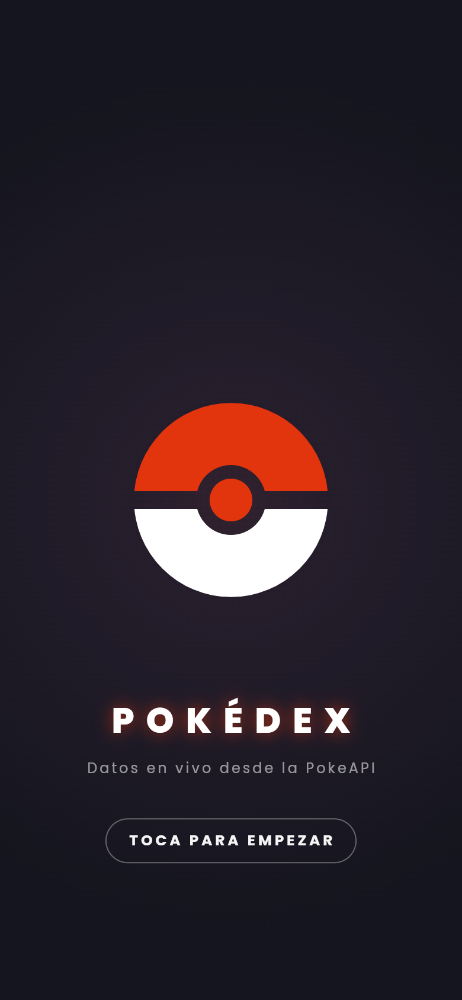
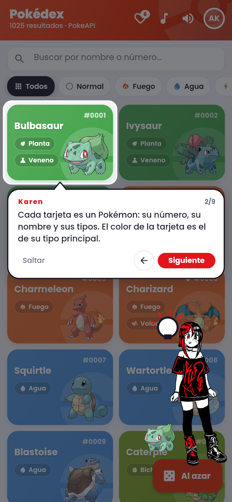
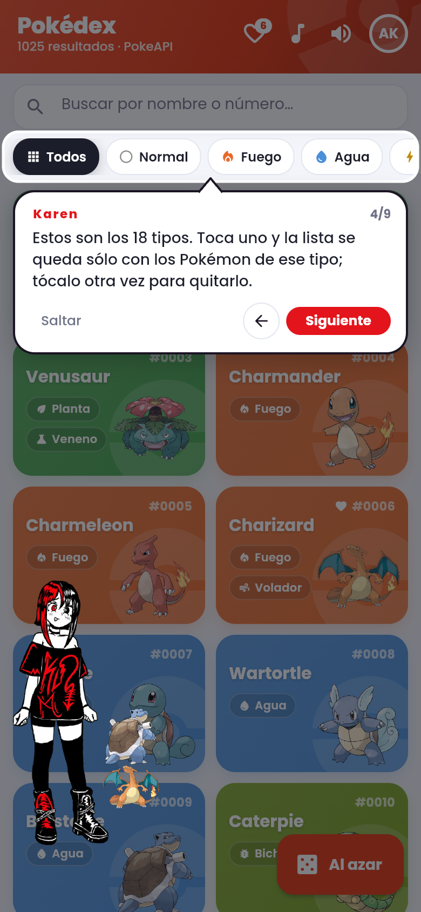
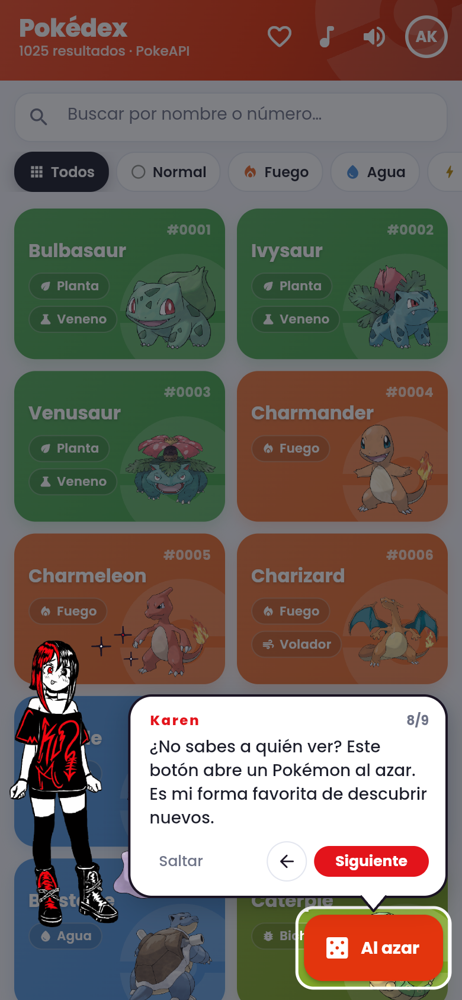
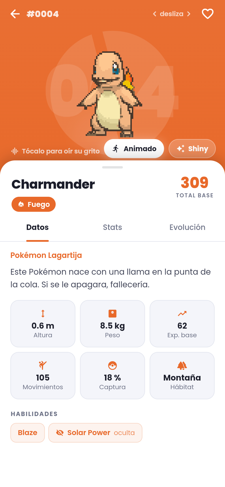
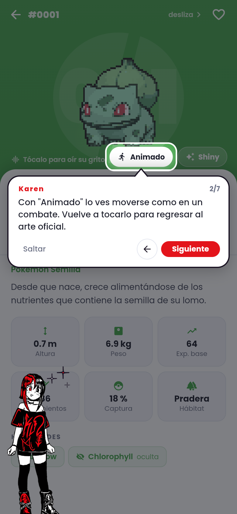
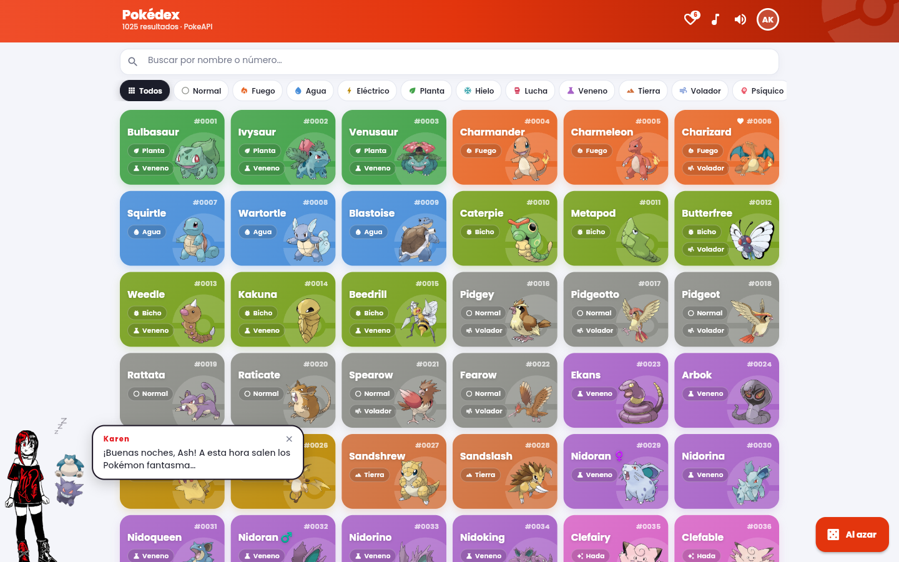
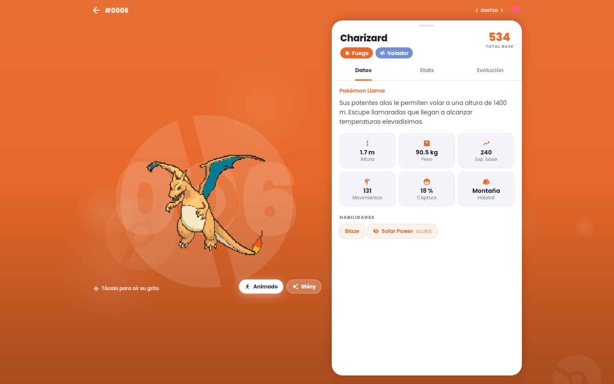

<p align="center">
  
</p>

<h1 align="center">Pokédex</h1>

<p align="center">
  La Pokédex nacional completa, 1025 Pokémon con datos en vivo de la PokeAPI: fichas, estadísticas, evoluciones, gritos reales, sprites animados y variocolor.<br>
  Con Karen, una mascota que te guía paso a paso y te cuenta datos curiosos mientras exploras.
</p>

<p align="center">
  <a href="https://jorgepizanosaucedo-crypto.github.io/Pokedex/"><strong>Abrir la app</strong></a>
</p>

<table>
  <tr>
    <td></td>
    <td></td>
    <td></td>
  </tr>
  <tr>
    <td></td>
    <td></td>
    <td></td>
  </tr>
</table>

<p align="center">
  
</p>
<p align="center">
  
</p>

## Qué hace

- **Pokédex nacional completa:** los 1025 Pokémon con buscador por nombre o número, filtro por los 18 tipos y tu equipo de favoritos guardado en el dispositivo.
- **Fichas vivas:** al abrir un Pokémon entra desde el costado y se presenta con un par de saltitos, respira, y al tocarlo suelta su grito real mientras se lanza hacia delante. Con **Animado** lo ves moverse con su sprite de combate, y con **Shiny** en su variocolor.
- **Todo lo que dice la PokeAPI:** descripción en español, medidas, habilidades (también las ocultas), radar de estadísticas y cadena evolutiva con las condiciones de cada cambio.
- **Karen, la mascota:** te guía la primera vez, paso a paso, iluminando cada parte de la pantalla y cambiándose de lado para no taparla. Al abrir tu primer Pokémon te explica la ficha con otra guía. Luego comenta lo que haces con más de 200 frases: saludos según la hora, datos curiosos de 48 Pokémon, comentarios por tipo, reacciones a tus favoritos, al shiny, a los filtros y a las búsquedas sin resultado.
- **Música y sonido:** un tema por ambiente que cambia con el tipo del Pokémon (los legendarios tienen el suyo), efectos de interfaz y la vocecita de Karen.
- **Hecha a la medida:** en el teléfono, todo apilado y a mano; en la computadora, cuadrícula compacta y la ficha en dos columnas.

## Cómo está hecho

- Flutter compilado a WebAssembly (con respaldo en JavaScript para navegadores viejos), publicado en GitHub Pages en cada push.
- Dio para la PokeAPI, con caché en memoria y la lista y los tipos guardados en el dispositivo: desde la segunda visita abre al instante.
- Arte oficial y sprites animados de [PokeAPI/sprites](https://github.com/PokeAPI/sprites) (los animados son los de Pokémon Showdown).
- En el navegador, los efectos de sonido van por Web Audio: se cargan una vez y suenan al instante, sin trabar el teléfono.
- Música, efectos y la voz de Karen sintetizados para el proyecto con los scripts de [`tools/`](tools/).

Corresponde a la actividad de consumo de APIs: añadir Dio, hacer la petición de
red, convertir la respuesta en objetos Dart y mostrarlos con Flutter.

## Los cuatro pasos de la práctica

| Paso | Dónde está |
|---|---|
| 1. Dio en las dependencias | [`pubspec.yaml`](pubspec.yaml) → `dio: ^5.11.1` |
| 2. Petición de red (`Future`, `Dio.get`) | [`lib/services/pokeapi_service.dart`](lib/services/pokeapi_service.dart) |
| 3. Respuesta → clase personalizada | [`lib/models/pokemon.dart`](lib/models/pokemon.dart) (`Pokemon.fromJson`) |
| 4. Obtener y mostrar los datos | [`lib/screens/`](lib/screens/) con `FutureBuilder` |

## Cómo ejecutarla

```bash
flutter pub get
flutter run -d chrome     # también: -d windows, -d android
```

### Probarla en el teléfono con GitHub Pages

El repositorio trae [`.github/workflows/pages.yml`](.github/workflows/pages.yml):
en cada push a `main`, GitHub compila la versión web (WebAssembly, con respaldo
en JavaScript) y la publica en
[`https://jorgepizanosaucedo-crypto.github.io/Pokedex/`](https://jorgepizanosaucedo-crypto.github.io/Pokedex/). Sólo hay que activarlo una vez en
**Settings → Pages → Source: GitHub Actions**. Después basta abrir ese enlace en
el teléfono (y, si se quiere, "Agregar a la pantalla de inicio").

En Windows de escritorio, Flutter necesita el **Modo de desarrollador** activado
para los plugins (`start ms-settings:developers`). En Chrome funciona sin eso.

```bash
flutter test       # pruebas del parseo de la PokeAPI
flutter analyze    # análisis estático
```

## Endpoints usados

| Endpoint | Para qué |
|---|---|
| `/pokemon?limit=1025` | lista completa de nombres e ids |
| `/pokemon/{id}/` | tipos, estadísticas, habilidades, arte, grito |
| `/pokemon-species/{id}/` | descripción (en español si existe), categoría, hábitat, si es legendario |
| `/evolution-chain/{id}/` | cadena evolutiva con sus condiciones |
| `/type/{nombre}/` | filtro por tipo con una sola petición |

Las respuestas se guardan en una caché en memoria dentro del servicio, y la
lista y el índice de tipos además se guardan en el dispositivo: a partir de la
segunda apertura la Pokédex aparece al instante, sin esperar a la red.

## Estructura

```
lib/
├── main.dart                     punto de entrada, tema y montaje de Karen
├── models/pokemon.dart           Pokemon, PokemonSpecies, EvolutionStep…
├── services/
│   ├── pokeapi_service.dart      cliente Dio + caché + errores legibles
│   ├── sound_service.dart        efectos de interfaz y gritos
│   ├── sfx/                      Web Audio para los efectos en el navegador
│   ├── music_service.dart        temas por tipo, fundidos y ciclo de vida
│   ├── karen_controller.dart     qué dice la mascota, cuándo, y sus dos guías
│   ├── karen_lines.dart          el repertorio de frases de Karen
│   ├── profile_store.dart        entrenador: nombre, foto y tipo favorito
│   ├── favorites_store.dart      favoritos persistidos
│   ├── settings_store.dart       música, sonidos y Karen encendidos o no
│   ├── session.dart              cerrar sesión y borrar datos
│   ├── artwork.dart              URLs del arte, tamaños y precarga
│   └── type_index.dart           tipos de los 1025 sin pedir uno por uno
├── theme/app_theme.dart          colores, tipos y tipografía
├── screens/
│   ├── splash_screen.dart        apertura con la pokébola
│   ├── login_screen.dart         registro, hoja de perfil, sesión y datos
│   ├── pokedex_screen.dart       cuadrícula, buscador y filtros
│   └── detail_screen.dart        ficha con pestañas y swipe
└── widgets/
    ├── karen_overlay.dart        la mascota: dibujo, acompañantes y globo
    ├── artwork_image.dart        arte oficial sin parpadeos ni esperas
    ├── animated_sprite.dart      sprite animado de combate sobre el arte
    ├── stats_view.dart           radar hexagonal y barras
    └── …                         tarjetas, destellos, fondo, avatar
```

## Karen, la mascota

Personaje original cedido por su autor para este proyecto (ver
[`assets/mascota/LICENSE.txt`](assets/mascota/LICENSE.txt)). El dibujo se usa sin
modificar; **no** está bajo la licencia del código.

Con un solo PNG se consigue que parezca viva, animando por capas:

- **El cuerpo** respira siempre, y según el ánimo salta, se inclina, tiembla,
  saluda o se mece. Son transformaciones del contenedor; el dibujo no se toca.
- **A su lado** la acompañan Pokémon que entran con un rebote y flotan a
  destiempo, siempre del lado de dentro de la pantalla y fuera de su silueta.
  Cambian según de qué esté hablando.
- **Reacciones manga** dibujadas con `CustomPainter` en su misma paleta (tinta
  y rojo): destellos, gota de sudor, `!`, `?`, bombilla, nube de pensamiento,
  corazón, notas y zzz.
- **El globo** se escribe letra por letra con una vocecita por carácter. Dura
  como mucho 2.6 s —los textos largos van más rápido—, el texto completo va
  invisible detrás para que el globo no crezca a saltos, y tocarlo lo completa.
- **Las guías**: la de la lista (9 pasos) sale al registrarte, y la de la
  ficha (7 pasos) al abrir tu primer Pokémon. Un velo oscurece la pantalla
  menos lo que explica; el globo se pega a eso con una flechita, y Karen camina
  al lado contrario para no taparlo. Se puede avanzar, volver o saltar.
- **Cuándo habla**: saludo según la hora, al abrir un Pokémon (un dato curioso
  si es uno de los 48 que conoce; si no, según sea legendario, muy fuerte, muy
  débil o de qué tipo), al marcar o quitar un favorito, al ver tu equipo, al
  filtrar por tipo, al activar shiny o el sprite animado, al oír el primer
  grito, al abrir las pestañas de estadísticas y evolución, cada tanto al
  deslizar, cuando una búsqueda no da resultados, cuando falla la red, y con
  consejos si te quedas parado.
- **Sin repetirse**: más de 200 frases en
  [`karen_lines.dart`](lib/services/karen_lines.dart). Cada categoría se
  reparte como una baraja: no repite ninguna hasta haber dicho todas.

## Tu sesión y tus datos

Tocar tu foto, arriba a la derecha, abre tu perfil. Desde ahí:

| Opción | Qué hace |
|---|---|
| **Cerrar sesión** | vuelve al registro y olvida tu nombre, foto y equipo |
| **Borrar lo descargado** | vacía la caché de la PokeAPI y de las imágenes; tu perfil se queda |
| **Borrar todos mis datos** | todo lo anterior y además los ajustes: la app queda como recién instalada |

Las dos acciones que no se pueden deshacer piden confirmación con un segundo toque.
También puedes repetir la guía de Karen o apagar sus consejos.

## Detalles de la interfaz

- **Registro de entrenador**: nombre, tipo favorito y foto de perfil libre
  (recortada y reducida a 256 px antes de guardarla). Todo queda en el
  dispositivo; no hay servidor.
- **Apertura animada**: la pokébola cae, rebota, tiembla y se abre en un destello.
  En el navegador espera un toque ("Toca para empezar"): los navegadores no
  dejan sonar nada antes de un gesto, y así la apertura sí suena y la música
  arranca con ella.
- **Fondo vivo**: degradado del color del tipo con orbes y pokébolas flotando,
  pintado en un `CustomPainter` aislado para no repintar el contenido.
- **Música por ambiente**: siete temas chiptune originales sintetizados por
  [`tools/generate_music.py`](tools/generate_music.py). El del mapa suena en la
  lista; al abrir una ficha cambia con fundido cruzado al ambiente de su tipo
  (fuego, agua, planta, eléctrico, siniestro) y los legendarios y singulares
  tienen el suyo, más solemne. Se aparta cuando suena un grito y se calla al
  pasar la app a segundo plano.
- **Presentación del Pokémon**: al abrir una ficha entra desde el costado
  girando y frenando, se presenta con dos saltitos y respira. Al tocarlo se
  lanza hacia delante y suelta su grito; cada 14 segundos lo hace solo.
- **Sprites animados**: el botón **Animado** cambia el arte oficial por el
  sprite de combate de Pokémon Showdown, en movimiento (también en shiny).
  Mientras baja se ve el arte; si un Pokémon no tiene sprite, el botón no sale.
  Se recuerda la elección.
- **Shiny**: cambia el arte oficial con una ráfaga de destellos y su sonido.
- **Radar de estadísticas**: hexágono dibujado a mano, escala fija 0–255 para no
  recortar ni exagerar ningún valor; cada eje con su nombre y su número, así la
  lectura nunca depende sólo del color.
- **Swipe entre fichas**: la ficha es un `PageView` sobre la lista filtrada.
- **Estados cubiertos**: carga con marcadores animados, vacío, y error de red con
  mensaje legible y botón de reintento.

### Imágenes sin esperas

El arte oficial son PNG de 475×475: casi 900 KB **ya decodificados** cada uno.
Mostrándolos tal cual, bajar deprisa por los más de mil de la lista desborda el
`ImageCache`, que empieza a expulsar y volver a decodificar, y se ven huecos.

[`artwork.dart`](lib/services/artwork.dart) y
[`artwork_image.dart`](lib/widgets/artwork_image.dart) lo resuelven así:

- **Dos tamaños**: la cuadrícula decodifica a 256 px; la ficha usa el original.
- **Caché en disco** con `cached_network_image` (en web, la del navegador).
- **Precarga**: la cuadrícula construye 1000 px por delante del scroll; al tocar
  una tarjeta se pide el arte grande antes de navegar, y en la ficha se precargan
  los vecinos del swipe y la versión shiny.
- **Sin pantallazo gris**: la ficha muestra al instante la miniatura que ya
  estaba en la tarjeta (el `Hero` la lleva volando) y encima aparece el arte
  grande cuando llega.
- [`main.dart`](lib/main.dart) le da a la caché de imágenes espacio para 600
  imágenes / 200 MB.

La tipografía Poppins va dentro de la app (`assets/fonts`), así que tampoco hay
un parpadeo de texto mientras se descarga.

### Rendimiento en el teléfono

- **WebAssembly**: la versión publicada se compila con `--wasm`, más rápida que
  JavaScript en los navegadores que lo soportan (los demás cargan la de
  JavaScript solos).
- **Efectos por Web Audio**: antes cada efecto creaba un `<audio>` nuevo; la
  vocecita de Karen, una por letra, trababa el teléfono.
- **Nada se mueve si no hace falta**: la pokébola de la cabecera ya no gira (la
  lista pedía fotogramas sin parar), las que giran tienen su propia capa, y el
  fondo de la ficha dibuja menos orbes en pantallas pequeñas.

## Dependencias

| Paquete | Uso |
|---|---|
| `dio` | cliente HTTP |
| `cached_network_image` | arte oficial con caché en disco |
| `audioplayers` | música, efectos de sonido y gritos |
| `flutter_cache_manager` | vaciar la caché de imágenes al borrar datos |
| `shared_preferences` | perfil y favoritos entre sesiones |
| `image_picker` | foto de perfil |
| `web` | Web Audio para los efectos en el navegador |

Los sonidos y la música de `assets/` no son de terceros: están sintetizados para este
proyecto con los scripts de [`tools/`](tools/), y se regeneran con
`python tools/generate_music.py` y `python tools/generate_voice.py`.

## Autor

Hecho por **Jorge Luis Pizano Saucedo** ([@jorgepizanosaucedo-crypto](https://github.com/jorgepizanosaucedo-crypto)).

Karen, la mascota, fue ilustrada por **Karen**. Pokémon y sus nombres son marcas
de Nintendo, Game Freak y The Pokémon Company; este es un proyecto escolar sin
fines de lucro.
